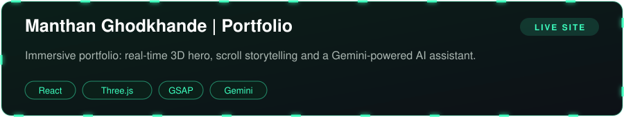
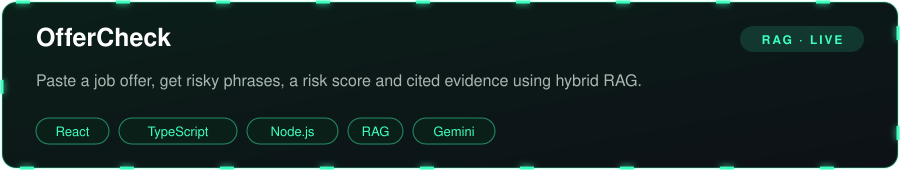
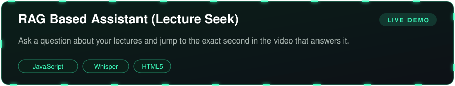
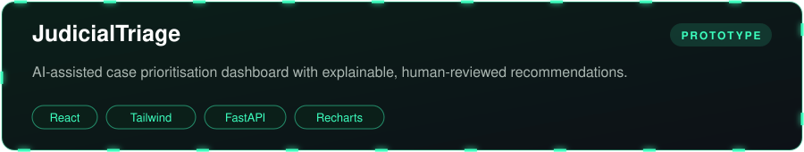

Data Science student turning ideas into real ML products — currently open to <b>internships and collaborations</b>.

- 🎓 Data Science student — turning raw data into useful predictions
- 🤖 Built end-to-end ML projects, including a **live Streamlit app** for house price prediction
- 🔎 Building **RAG systems**: OfferCheck (job-offer fraud checks) and Lecture Seek (search inside lecture videos)
- 📊 Full pipeline: cleaning → EDA → model training → deployment
- 💻 **Python**, Scikit-Learn, Pandas, NumPy, Seaborn
- 🌱 Now: Feature Engineering, Hyperparameter Tuning, Power BI dashboards, Deep Learning with TensorFlow
- 🎯 Goal: a Data Science internship working on real-world ML problems

<b>Languages & Web</b> 

<b>Data & ML</b> 

<b>Deep Learning & AI</b> 

<b>Tools & Deploy</b> 

<b>Creative</b> 

<a href="https://manthan-portfolio-phi.vercel.app/">▶ Live demo</a> · <a href="https://github.com/manthan707-ds/MANTHAN.portfolio">Source code</a>

<a href="https://offercheck-rag-based.vercel.app">▶ Live demo</a> · <a href="https://github.com/manthan707-ds/Offercheck-RAG-based">Source code</a>

<a href="https://rag-based-assistant-psi.vercel.app/">▶ Live demo</a> · <a href="https://github.com/manthan707-ds/RAG-Based-Assistant-">Source code</a>

<a href="https://judicial-triage.vercel.app">▶ Live demo</a> · <a href="https://github.com/manthan707-ds/Judicial-Triage">Source code</a>

Open to internships, collaborations and good ML problems. Say hi 👋

⭐ From Manthan

